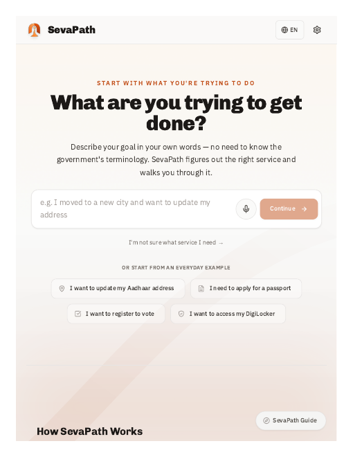

# SevaPath — Civic Services Guide

SevaPath is a full-stack civic services guide for India. It walks citizens through 11 government services — Aadhaar updates, passports, voter registration, scholarships, and more — with eligibility checks, required documents, and step-by-step procedures in English, Hindi, and Tamil.

A Gemini-powered AI copilot answers questions about any of the services. The React frontend and FastAPI backend are both deployed on Vercel and talk to each other through a CORS-secured API.

**Live demo:** https://sevapath.vercel.app/

## Features

- 11 government services with full procedure guides
- English, Hindi, and Tamil translations
- AI copilot (Gemini primary, OpenAI fallback) for citizen queries
- Eligibility checks and required-document lists per service
- React frontend + FastAPI backend, deployed serverless on Vercel

## Tech stack

React (Create React App) · FastAPI · Google Gemini API · Vercel

---

## Production Deployment Architecture

SevaPath supports deployment with separate origins for the frontend (e.g. Vercel) and the backend (e.g. Render). Because the frontend and backend live on different domains in production, specific environment variables are REQUIRED for them to communicate securely.

### Frontend Deployment

When deploying the React frontend, you MUST define the absolute URL of the deployed FastAPI backend.
- **Environment Variable:** `REACT_APP_BACKEND_URL`
- **Example:** `REACT_APP_BACKEND_URL=https://api.sevapath.com`

*Important:* Because this is a Create React App, environment variables are baked in at build time. After setting or changing `REACT_APP_BACKEND_URL`, you must rebuild and redeploy the frontend.

### Backend Deployment

When deploying the FastAPI backend, you MUST allow the absolute URL of the deployed React frontend so the browser does not block the requests (CORS).
- **Environment Variable:** `CORS_ORIGINS`
- **Example:** `CORS_ORIGINS=https://sevapath.vercel.app`

*Important:* Both the frontend and backend should be deployed over HTTPS to ensure secure communication and to allow browser APIs (like Voice Input and the Camera) to function correctly.

## Deploy everything on Vercel (frontend + backend)

Both halves of SevaPath run on Vercel as two projects from this one repo.
Deploy the **backend first**, then the frontend.

### 1. Backend project

- **Root Directory:** `backend`
- `backend/api/index.py` is the serverless entrypoint — it imports the same
  FastAPI `app` from `server.py`, so the exact code that runs locally with
  uvicorn runs on Vercel. No code changes needed.
- `backend/vercel.json` rewrites every `/api/*` request to that function.
- `backend/requirements.txt` is the slim production dependency set (verified
  against every route); `backend/requirements-dev.txt` adds the test/lint
  tooling for local work.
- **Environment variables:**
  - `CORS_ORIGINS` — the frontend's Vercel URL (set after step 2, then redeploy)
  - `GEMINI_API_KEY` / `OPENAI_API_KEY` — optional; the API runs in degraded
    mode without them (`/api/status` reports provider state, never key values)
  - `MONGO_URL` / `DB_NAME` — optional; the server starts fine without a database

### 2. Frontend project

- **Root Directory:** `frontend` (Create React App + craco — auto-detected)
- **Environment variable:** `REACT_APP_BACKEND_URL` = the backend project's
  Vercel URL (e.g. `https://sevapath-backend.vercel.app`). CRA bakes this in
  at build time, so set it **before** the first deploy.

### 3. Wire them together

1. Deploy backend → copy its `https://*.vercel.app` URL.
2. Deploy frontend with `REACT_APP_BACKEND_URL` set to the backend URL.
3. Add the frontend URL to the backend's `CORS_ORIGINS` and redeploy the backend.

## Local Development

For local development, simply run:
1. Backend: `uvicorn server:app --reload`
2. Frontend: `yarn start` (Defaults to `http://localhost:3000`)

The local environment is pre-configured to communicate seamlessly.
